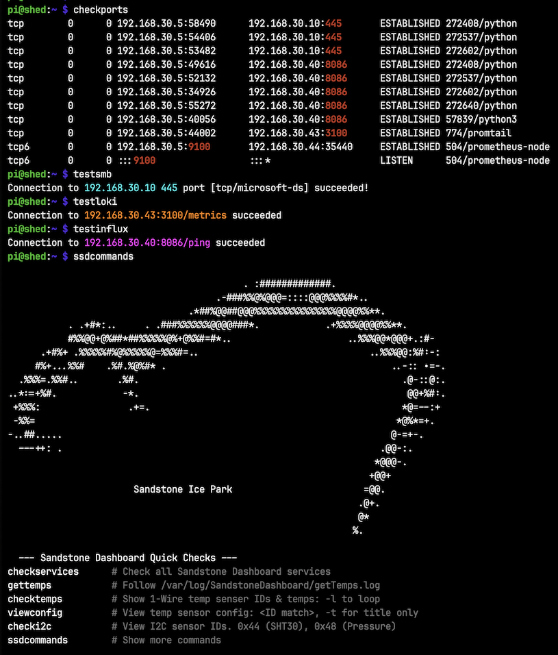
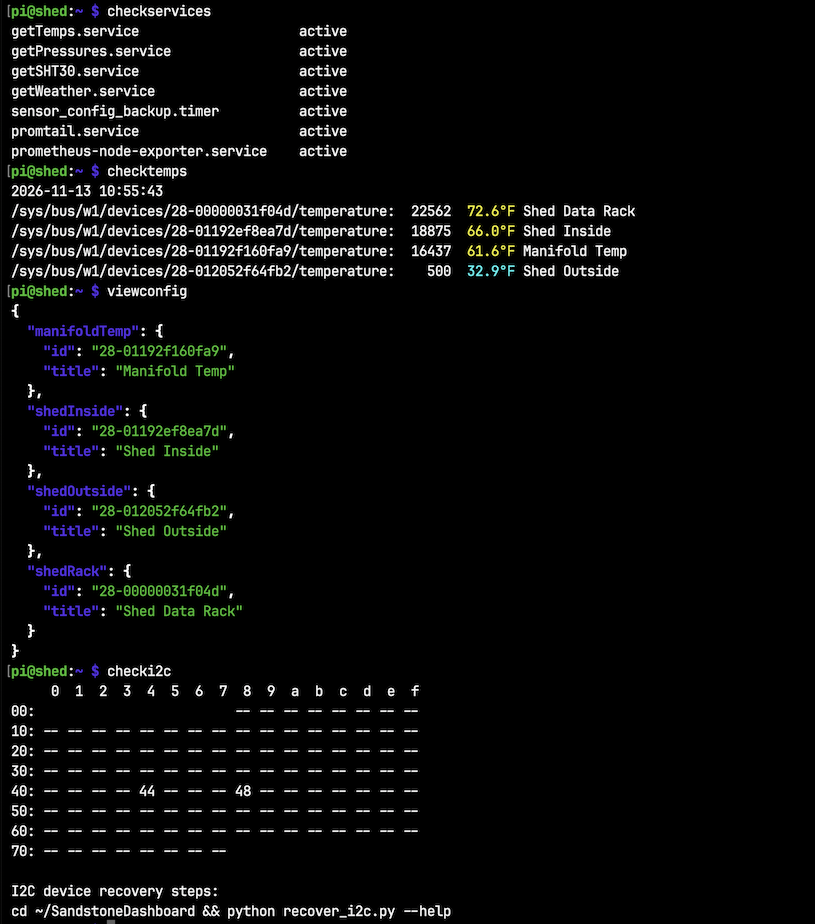

# Bash




The default .bashrc file sources .bash_aliases, but not .bash_functions  
The Ansible playbook manages the block to source .bash_fuctions  
Verify both blocks are present and not duplicated .bashrc

```shell
if [ -f ~/.bash_aliases ]; then
    . ~/.bash_aliases
fi
```

```shell
if [ -f ~/.bash_functions ]; then
    . ~/.bash_functions
fi
```
